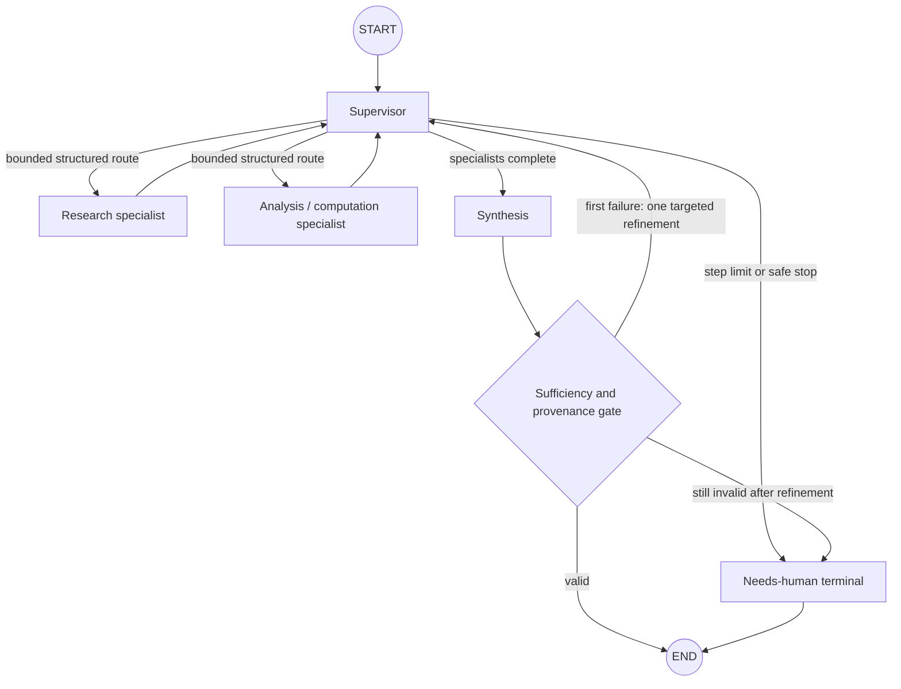

# Multi-Agent Research Orchestrator

A small, locally runnable Pre-entrega 6 prototype: a LangGraph supervisor delegates retrieval and deterministic analysis, validates provenance and completeness, then synthesizes a cited answer. No hosted search service, paid API, or model download is needed.

## Topology



The graph uses `StateGraph` and conditional edges with `Literal`-typed route functions. The supervisor owns the shared `AgentState` (a `MessagesState` subclass); specialists receive only the current request and relevant evidence, and return attributed contribution records. Reducers merge contributions and route events instead of overwriting them. An `InMemorySaver` checkpoints each invocation by `configurable.thread_id`.

### Why this topology

- Research and computation are separate capabilities: the Research specialist queries the included Chroma vector collection; Analysis validates fixture fields and computes metrics in ordinary Python.
- The Supervisor controls sequencing and can only select a route from a small state-dependent candidate set. The local LLM, when available, returns JSON that is checked against those candidates; a deterministic route is the fallback.
- A state guard enforces research before analysis and analysis before synthesis, even if a model proposes a later stage too early. The route trace distinguishes an accepted `ollama` decision from a deterministic fallback or ordering guard.
- Synthesis is deterministic and grounded in specialist outputs. It does not ask a language model to author arithmetic.
- The validator accepts citations only when they refer to retrieved source IDs, checks all required metrics and their ranges, and permits at most one targeted refinement. A second failure ends in a needs-human response.
- `max_steps` (default 8) independently bounds supervisor visits. Refinement is also one-shot, so neither the router nor a malformed answer can create an unbounded cycle.

### Evidence and conflict handling

Research contributions retain the Chroma result IDs and source text. The calculation tool only accepts a fixture attached to retrieved evidence, validates `k`, row types, relevant counts, and count bounds, and reports its source ID. If retrieved prose and fixture data disagree, the deterministic fixture schema is the sole calculation input; prose cannot override the numeric result. Unsupported citations or incomplete/conflicting output fail validation, trigger one targeted retrieval or calculation refinement, and then stop safely for human review. The system never silently resolves unsupported evidence by model preference.

## Quickstart (Windows PowerShell)

Requirements: Python 3.12 and `uv`. From this directory:

```powershell
uv venv --python 3.12 .venv
uv sync --locked
```

Run the fully offline test suite:

```powershell
.venv\Scripts\python.exe -m pytest -q
```

Run the async demo (it tries the local Ollama endpoint first, then falls back to deterministic routing):

```powershell
.venv\Scripts\python.exe -m orchestrator.demo
```

Open `demo.ipynb` in Jupyter to see the request, supervisor trace, each specialist's attributed contribution, validated answer, and checkpoint lookup in one output cell. The notebook's saved output records the backend used when it was executed.

The included notebook output was executed against the local `qwen3.5:4b-q4_K_M` Ollama model. Ollama selected synthesis; deterministic state guards kept the earlier specialist order as Research → Analysis. The reported numeric answer comes from the deterministic calculation tool, not the model.

## Local model configuration

Only the supervisor's route decision uses a model. By default, `auto` tries the OpenAI-compatible Ollama endpoint at `http://127.0.0.1:11434/v1` with `qwen3.5:4b-q4_K_M`, then uses a constrained deterministic fallback if the service or response is unavailable. The model/base URL are configurable; no hosted key is required.

```powershell
$env:ORCHESTRATOR_PROVIDER = "ollama" # auto | ollama | offline
$env:ORCHESTRATOR_BASE_URL = "http://127.0.0.1:11434/v1"
$env:ORCHESTRATOR_MODEL = "qwen3.5:4b-q4_K_M"
$env:ORCHESTRATOR_TIMEOUT_SECONDS = "30"
```

Use `ORCHESTRATOR_PROVIDER=offline` to disable model calls. Tests inject a fake router and never depend on Ollama or network access. Research uses a tiny included corpus with deterministic hash embeddings in a real local Chroma vector database; it downloads no embedding model.

## Persistence boundary

The demo's `InMemorySaver` demonstrates async graph invocation and thread-scoped checkpoints, but checkpoint data exists only in the current process. Use LangGraph's async SQLite or PostgreSQL checkpointer for durable multi-process/production state. Chroma is also ephemeral for this prototype and is seeded from `data/sources.json` at graph construction.

## Repository map

- `src/orchestrator/graph.py` — supervisor, graph edges, validation, one-refinement and step bounds.
- `src/orchestrator/state.py` — shared state, attributed contributions, and route trace types.
- `src/orchestrator/agents/` — focused Research and Analysis specialist nodes.
- `src/orchestrator/tools/knowledge_base.py` — local Chroma corpus search and stable hash embeddings.
- `src/orchestrator/tools/calculations.py` — validated deterministic macro metric calculation.
- `data/sources.json` — cited fixture and short corpus.
- `tests/` — offline tool, routing, validation, bound, and checkpoint tests.
- `demo.ipynb` — async end-to-end demonstration with saved output.
